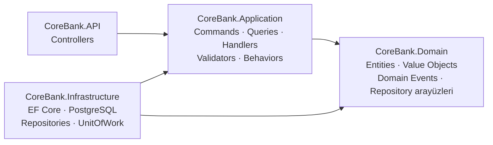
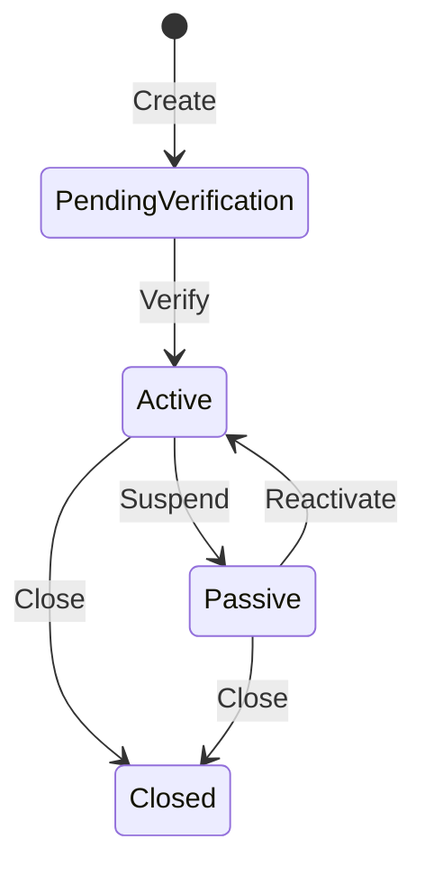

# CoreBank

Bir bankacılık çekirdek sisteminin (core banking) sadeleştirilmiş modeli. **.NET 10** ile **Clean Architecture**, **CQRS** ve **Domain-Driven Design** prensipleri uygulanarak geliştirildi.

Amaç, iş kurallarını framework ve veritabanından bağımsız tutan, test edilebilir ve yeni özellik eklendiğinde mevcut kodu bozmayan bir backend yapısı kurmak.

## Teknolojiler

- .NET 10, ASP.NET Core Web API
- MediatR (CQRS, pipeline behaviors, domain event yayını)
- FluentValidation
- ErrorOr (Result pattern → HTTP ProblemDetails)
- Entity Framework Core 10 + PostgreSQL 16
- Docker Compose
- xUnit + FluentAssertions

## Mimari



Bağımlılıklar her zaman içe doğrudur. **Domain** hiçbir projeye bağımlı değildir; repository arayüzleri Domain'de tanımlanır, gerçek kodları Infrastructure'dadır.

| Katman | Sorumluluk |
|---|---|
| **API** | HTTP isteğini alır, MediatR'a gönderir, sonucu HTTP koduna çevirir. İş mantığı içermez. |
| **Application** | Her işlem ayrı bir Command veya Query ve kendi Handler'ı. Girdi doğrulama, use-case akışı. |
| **Domain** | İş kuralları: `Customer`, `Account`, `Money`, durum geçişleri, domain event'ler. |
| **Infrastructure** | EF Core `DbContext`, entity konfigürasyonları, migration'lar, repository ve UnitOfWork. |

## Öne çıkan tasarım kararları

**CQRS + MediatR.** Yazma (`CreateCustomer`, `VerifyCustomer`, `SuspendCustomer`) ve okuma (`GetCustomerById`) işlemleri ayrı sınıflardadır. Controller sadece `_mediator.Send(...)` çağırır. `ICommand`, `IQuery` ve handler arayüzleri `Abstractions/Messaging` altında tanımlıdır.

**Merkezi doğrulama.** `ValidationBehavior`, MediatR pipeline'ına eklenmiştir. Her istek handler'a ulaşmadan önce ilgili FluentValidation kurallarından geçer (TCKN 11 hane, TR cep telefonu formatı, 18 yaş üstü vb.). Handler'larda tekrar tekrar doğrulama kodu yazılmaz.

**Result pattern.** Domain, iş kuralı ihlallerinde exception fırlatmaz; `Result.Failure(...)` döner. Application katmanı bunu `ErrorOr` hatasına çevirir, controller da hata tipine göre RFC 9457 ProblemDetails yanıtı üretir:

| Hata tipi | HTTP |
|---|---|
| Validation | 400 |
| NotFound | 404 |
| Conflict (ör. aynı TCKN ile kayıt, geçersiz durum geçişi) | 409 |

**Zengin domain modeli.** Entity'ler `private set` ve fabrika metotlarıyla (`Customer.Create`, `Account.Open`) oluşturulur; geçersiz nesne yaratılamaz. `Customer` bir durum makinesidir:



`Money` bir value object'tir: negatif tutar kabul etmez, farklı para birimleriyle toplama/çıkarma yapılmasını engeller.

**Domain event'ler.** Entity'ler durum değişikliklerinde event üretir (`CustomerCreated`, `CustomerVerified`, `AccountOpened`, `MoneyDeposited` …). `CoreBankDbContext.SaveChangesAsync` bu event'leri toplayıp MediatR ile yayınlar; örneğin `CustomerVerifiedHandler` olayı loglar. Bildirim gönderme gibi yan etkiler bu noktaya, domain koduna dokunmadan eklenebilir.

## API

| Metot | Endpoint | Açıklama |
|---|---|---|
| `POST` | `/api/customers` | Yeni müşteri oluşturur (`PendingVerification`) |
| `GET` | `/api/customers/{id}` | Müşteri bilgisini getirir |
| `POST` | `/api/customers/{id}/verify` | Müşteriyi doğrular (`Active`) |
| `POST` | `/api/customers/{id}/suspend` | Müşteriyi askıya alır (`Passive`) |

Örnek istek:

```json
POST /api/customers
{
  "tckn": "12345678901",
  "firstName": "Ayşe",
  "lastName": "Yılmaz",
  "dateOfBirth": "1995-04-12",
  "phoneNumber": "05321234567",
  "email": "ayse@example.com"
}
```

## Çalıştırma

```bash
# PostgreSQL'i başlat
docker compose up -d db

# Migration'ları uygula
dotnet ef database update --project CoreBank.Infrastructure --startup-project CoreBank.API

# API'yi çalıştır
dotnet run --project CoreBank.API
```

OpenAPI dokümanı geliştirme ortamında `/openapi/v1.json` adresindedir.

## Testler

```bash
dotnet test
```

Domain testleri `Account` için hesap açma, para yatırma ve çekme işlemlerinin doğru domain event'leri ürettiğini doğrular.

## Yol haritası

- [ ] Hesap (Account) işlemleri için command/query ve endpoint'ler
- [ ] Hesaplar arası transfer (UnitOfWork transaction ile)
- [ ] Customer domain testleri ve handler birim testleri
- [ ] Global exception handling ve loglama pipeline behavior'ı
